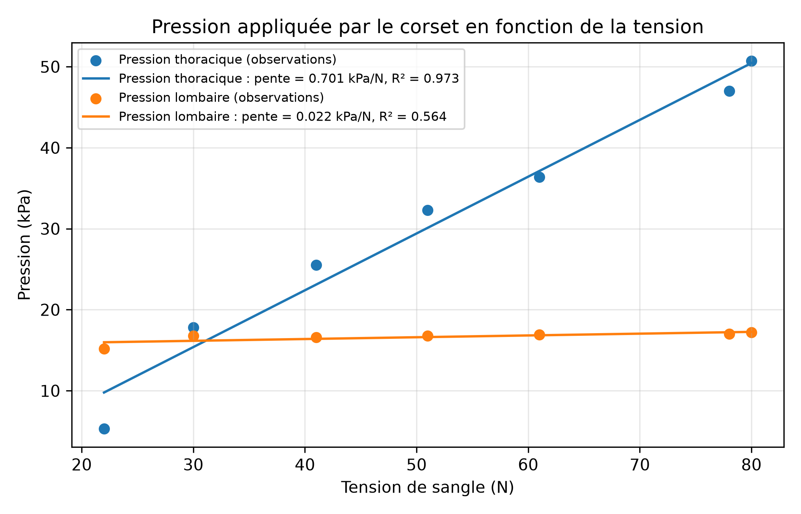
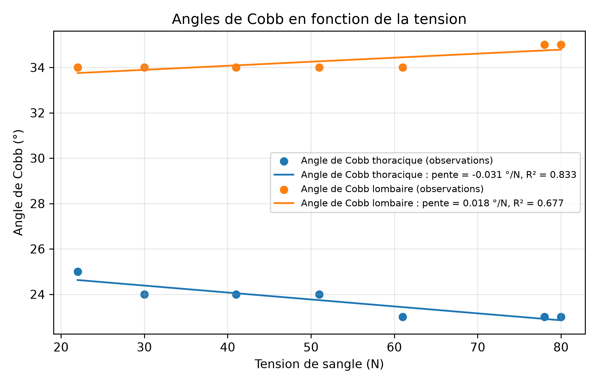

# Rapport 
## Introduction
La relation entre la tension de sangle de corset orthopédique pour la scoliose idiopathique de l'adolescent (SIA), la pression appliquée par le corset sur le tronc et la correction est variée (Luo et al, 2024).  

## Question de recherche
Quelle est la relation entre la tension de sangle, la pression et la correction? 

## Objectif
Déterminer la relation entre la tension de sangle d'un corset orthopédique, la pression qu'il applique sur le tronc, et la correction. 

## Description de l'ensemble des données 
Les données de pression ainsi que les angles de Cobb (i.e: indicateurs de correction) thoracique et lombaire en fonction de la tension de sangles sont disponibles pour le patient P2 de l'étude de Guy et al, "Biomechanical effects of Thoracolumbosacral Orthosis Design Features on 3D Correction in Adolescent Idiopathic Scoliosis: A Comprehensive Multicenter Study" (Guy et al., 2022). Les données figurent dans un dépôt demo.borealis, sous la licence CC-BY-NC 4.0. Veuillez consulter le [README](./README.md) pour plus de détails sur la disponibilité de ces données.

## Méthodologie 
- Pour le patient P2, un modèle de régression linéaire est utilisé pour déterminer la relation entre les pressions en fonction de la tension au niveau thoracique et lombaire respectivement. 
- Un modèle de régression linéaire est également utilisé pour déterminer la relation entre les angles de Cobb en fonction de la tension au niveau thoracique et lombaire respectivement.
- Un coefficient de détermination est calculé pour déterminer si le modèle de régression linéaire est approprié pour décrire les données.
Un test t bilatéral sera effectué avec un niveau de signification de 5% pour pour déterminer si la relation linéaire est significative.

## Résultats 

Le tableau 1 résume les résultats de régression linéaire entre la pression en fonction de la tension de sangle dans chacune des zones. Le tableau 2 résume ensuite les résultats de régression linéaire entre la correction en fonction de la tension dans chacune des zones. 

Tableau 1: Résultats de la régression linéaire pour la pression. 
| Zone | Pente (kPa/N) | Ordonnée à l'origine (kPa) | Coefficient de détermination R^2 |
|--------------|-----------------|--------|------|
| Thoracique      | 0.701| -5.649 | 0.973 |
|Lombaire    | 0.022  | 15.497 | 0.564 |

Tableau 2: Résultats de la régression linéaire pour la correction, définie par les angles de Cobb. 
| Zone | Pente (°/N) | Ordonnée à l'origine (°) | Coefficient de détermination R^2 |
|--------------|-----------------|--------|------|
| Thoracique      | -0.031 | 25.302 | 0.833 |
|Lombaire    | 0.018  | 33.362 | 0.677 |

Le tableau 3 présente l'ensemble des résultats de l'analyse statistique. 

Tableau 3: Résultats de la régression linéaire pour la correction, définie par les angles de Cobb. 
| Variable dépendante | Statistique t | p-value | Taille d'échantillon n |
|--------------|-----------------|--------|------|
| Pression thoracique      | 13.49 | <0.001 | 7 |
|Pression lombaire    | 2.55 | 0.052 | 7 |
| Angle de Cobb thoracique      | -4.99 | 0.004 | 7 |
|Angle de Cobb lombaire    | 3.24  | 0.023 | 7 |

Le modèle de régression linéaire semble décrire le mieux la relation entre la pression appliquée par le corset au niveau thoracique en fonction de la tension (R^2=0.973) (Tableau 1) de manière significative (p<0.001) (Tableau 3).

De manière plus générale, les résultats semblent démontrer que les relations entre les paramètres et la tension diffèrent entre les zones thoracique et lombaire. Les modèles linéaires semblent mieux convenir au niveau thoracique pour la pression et l'angle de Cobb (R^2=0.973 et R^2=0.833 respectivement) (Tableau 1, Tableau 2) et semblent être significatives (p<0.001 et p = 0.004 respectivement) (Tableau 3). Cependant, les modèles linéaires ne semblent pas adaptés au relations observées au niveau lombaire pour la pression et l'angle de Cobb (R^2=0.564 et R^2=0.677 respectivement) (Tableau 1, Tableau 2). 

Les différences entre les deux zones peuvent être observées avec des graphiques des régressions linéaires ainsi que les points d'observations pour la pression en fonction de la tension (Figure 1), et la correction en fonction de la tension (Figure 2). Tandis que les données et courbes au niveau thoracique suivent une certaine linéarité en fonction de la tension de sangle, nous observons que les courbes et données au niveau lombaire semblent démontrer une indépendance en fonction de la tension de sangle pour la pression (p=0.052) (Tableau 3) et possiblement l'angle de Cobb (p=0.023) (Tableau 3). 

Figure 1: Les données observées ainsi que les modèles de régression linéaire pour la pression en fonction de la tension.

Figure 2: Les données observées ainsi que les modèles de régression linéaire pour l'angle de Cobb en fonction de la tension.

Ces différentes tendances pourraient potentiellement s'expliquer par la présence de côtes en zone thoracique. Ces dernières servent d'appuis pour le corset puisse corriger, au détriment de causer des points de pressions. L'absence de structures osseuses au niveau lombaire près de la peau pourrait suggérer une diminution d'efficacité de correction du corset dans cette zone, mais d'une meilleure répartition des pressions sur le tronc du patient. Cependant, pour vérifier et valider ces tendances, la relation entre les paramètres doit être étudiée chez une plus grande population de patients atteints de la SIA. 

## Conclusion
La relation entre la tension, la pression et la correction diffère entre les zones thoracique et lombaire, où la tendance linéaire semble mieux s'adapter au niveau thoracique que lombaire. Une plus grande cohorte de patients serait requise pour valider et généraliser la relation. 

## Références

Luo, C., Wu, H., Liu, W., Luo, Y., Jie, Y., Ma, C. Z., & Wong, M. (2024). The Biomechanics of Spinal Orthoses for Adolescent Idiopathic Scoliosis: A Systematic Review of the Controlling Forces. Bioengineering, 11(12), 1242. https://doi.org/10.3390/bioengineering11121242

Guy, A., Coulombe, M., Labelle, H., Rigo, M., Wong, M.-S., Beygi, B. H., . . . Aubin, C.-É. (2022). Biomechanical Effects of Thoracolumbosacral Orthosis Design Features on 3D Correction in Adolescent Idiopathic Scoliosis: A Comprehensive Multicenter Study. Spine, 47(15). https://journals.lww.com/spinejournal/fulltext/2022/08000/biomechanical_effects_of_thoracolumbosacral.9.aspx
